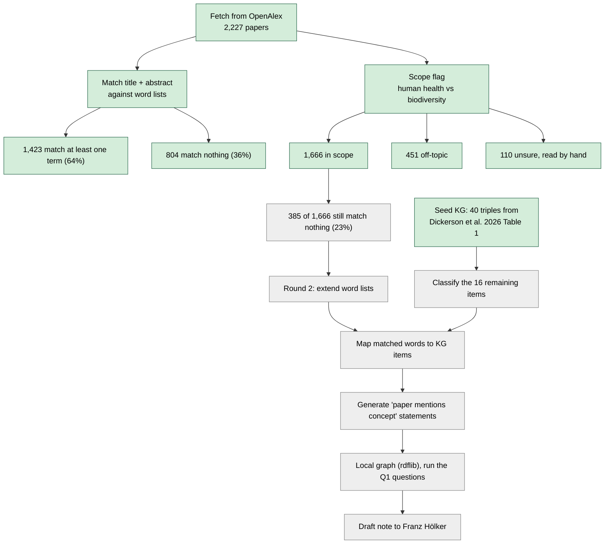

# alan-literature-mining

A pipeline that mines the scientific literature on artificial light at night (ALAN) and turns it into a knowledge graph about how light is measured. It is built to answer one question: **how can light measurement methods be harmonized across disciplinary boundaries?** (Q1 of Hölker et al. 2021, "11 pressing research questions on how light pollution affects biodiversity").

> **Status: work in progress.** See [Current status](#current-status) for what works today and what is still planned.

## Why this exists

Astronomers, lighting engineers, ecologists and biologists all measure light, but they use different instruments, quantities and units (lux, cd/m², W/m², mag/arcsec², µmol/m²/s, ...). This makes results hard to compare. This project collects what the literature says about methods, quantities, units, disciplines and studied organisms, and structures it as a graph of linked statements ("triples") that can be queried, for example:

- Which disciplines use which measurement methods?
- Which quantities does each method measure?
- Which units report each quantity, and who reports them?
- Which papers mention a given method?

The graph is intended to be hosted in a Wikibase instance.

## How it works

1. **Fetch** papers from OpenAlex (and later Europe PMC) for a defined search and date window.
2. **Match** the title and abstract of each paper against controlled word lists (rules, no machine learning).
3. **Tabulate** the results as a CSV: one row per paper, with the matched terms per category.
4. **Flag scope** by marking papers about human health, rather than biodiversity, as off-topic (see [Scope: biodiversity, not human health](#scope-biodiversity-not-human-health)).
5. **Curate** a seed set of statements by hand from review papers (`kg/seed_statements.csv`).
6. **Build** the knowledge graph from the curated statements plus the paper-to-concept links.

The work is done in rounds: scan with the current word lists, review what was missed, extend the lists, scan again.

## Repository structure

```
alan-literature-mining/
├── README.md
├── plan.md                  # plan and criteria for "enough"
├── questions.md             # questions the graph should answer, with expected answers
├── requirements.txt         # pinned Python packages
├── vocab/
│   └── terms.py             # word lists: search terms, methods, quantities, units, disciplines, taxa, human-health terms
├── src/
│   └── fetch_openalex.py    # downloads papers from OpenAlex into a CSV
├── notebooks/
│   └── 01_explore_openalex.ipynb   # term matching, scope flag, summary numbers, output table
├── kg/
│   ├── seed_statements.csv  # hand-curated statements (subject, property, object, source)
│   └── items.csv            # class of each item (quantity, instrument, spectral band, ...)
└── data/
    ├── raw/                 # downloaded data (not tracked by Git)
    └── output/              # result tables (not tracked by Git)
```

## Setup

You need Python 3.9 or newer and Git.

```bash
git clone https://github.com/VasundharaShaw/alan-kg.git
cd alan-kg
python3 -m venv .venv
source .venv/bin/activate
pip install -r requirements.txt
mkdir -p data/raw data/output
```

### OpenAlex API key

OpenAlex offers a free API key, which gives a much larger daily budget than anonymous use. Create an account at openalex.org, copy your key from the API settings page, and make it available as an environment variable (never write it into the code or commit it):

```bash
export OPENALEX_API_KEY="your-key"
```

The variable lasts for the current terminal window only.

### Working behind a proxy or VPN

If your institution sets proxy variables in the terminal and downloads fail with "Cannot connect to proxy", you can clear them for the current window:

```bash
unset http_proxy https_proxy HTTP_PROXY HTTPS_PROXY
```

## Usage

**1. Download the papers**

```bash
python src/fetch_openalex.py
```

This queries OpenAlex for `"artificial light at night"`, English-language works published between 2024-10-27 and 2026-10-27, pages through all results (100 per request) and writes `data/raw/openalex_alan.csv` with these columns:

| Column | Meaning |
|---|---|
| `first_author` | display name of the first author |
| `year` | publication year |
| `venue` | journal or source |
| `title` | paper title |
| `doi` | DOI |
| `is_open_access` | whether the paper is open access |
| `abstract` | abstract, rebuilt from OpenAlex's word-position index |

**2. Match terms**

Open `notebooks/01_explore_openalex.ipynb` in VS Code, select the `.venv` kernel, and run the cells. The notebook adds one column per category (`methods`, `quantities`, `units`, `disciplines`, `species`) listing the terms found in each paper's title and abstract, then the scope columns `human_health` and `scope` (see below), prints summary numbers, and saves the table to `data/output/table_abstracts.csv`. The table keeps all the columns of the raw download.

After editing `vocab/terms.py`, restart the kernel and run all cells again, because Python keeps the old word lists in memory. A progress log at the top of the notebook records the effect of each change to the word lists.

## Word lists and matching rules

All vocabulary lives in `vocab/terms.py` as plain Python lists, so it can be reviewed and edited without touching the code. The first version was drawn from Hölker et al. (2021) and is extended in rounds using Dickerson et al. (2026).

- Abbreviations in capitals (for example SQM, PAR, DSLR) must match exactly, so that they do not match ordinary words.
- Other terms ignore case and also match a plural ("moth" matches "moths").
- Terms match whole words only, and a term must start at a word boundary: "bird" does not match "seabird" and "fish" does not match "zebrafish". Compounds and irregular plurals ("mouse" and "mice") need their own entries.
- `HUMAN_HEALTH` is not one of the five categories. It is used only for the scope flag below.
- Species are found with a word list of taxa, not with a language model. This is transparent and reproducible, but only finds what is on the list.

## Scope: biodiversity, not human health

The search phrase also returns many papers on human health (sleep, circadian disruption, cancer and similar). The project follows Hölker et al. (2021), which is about biodiversity, so these papers are off-topic unless they are about animals. The notebook flags them with word lists, not with a classifier:

- A paper is **flagged** when its title and abstract contain a word from `HUMAN_HEALTH` in `vocab/terms.py` and no species word from `TAXA`.
- Flagged papers are split three ways in the `scope` column:
  - `off-topic`: two or more health terms, or one strong term (for example cancer, patient, diabetes)
  - `unsure`: one weak term only (for example sleep, participant, clinical); these are read by hand
  - `in scope`: everything else

Because the animal exception depends on the taxa list, an animal paper whose organism is not yet listed can be flagged, which is why animal terms are added to `TAXA` as they turn up. Laboratory rodents (mouse, mice, rat) are currently treated as animals and stay in scope. The notebook prints samples of flagged papers so the rule can be checked by eye.

## The seed knowledge graph

`kg/seed_statements.csv` holds statements entered by hand from review papers, currently Table 1 of Dickerson et al. (2026). Each row is one triple with its source:

```
subject,property,object,source
illuminance,reported_in,lx,Dickerson 2026 Table 1
```

Rules for this file: lowercase spelling throughout, one value per cell, no commas inside values, plain-text units (`W/m2/sr`, `umol/m2/s`).

| Property | Meaning |
|---|---|
| `reported_in` | a quantity is reported in a unit |
| `used_by` | a quantity or instrument is typically used by a discipline or user group |
| `photometric_version_of` | the quantity weighted by human eye sensitivity |
| `spectral_version_of` | the wavelength-resolved version of a quantity |
| `photon_version_of` | the photon-count version of a quantity |
| `expresses` | a quantity or unit expresses another quantity |
| `given_in_band` | a quantity is given in a spectral band |
| `measures` | an instrument measures a quantity |
| `can_derive` | an instrument can derive a quantity |
| `often_reported_for` | a quantity is often reported for a purpose |

## Known limitations

- A match in an abstract means a term is **mentioned**, not that a method was **used**. Links derived from word-list matches mean "mentioned together".
- Papers without an abstract (about 9% of the first download) can only be matched on their title.
- Only titles and abstracts are scanned. Instruments, methods and units usually appear in the Methods section, so they are under-reported compared with species and disciplines.
- Word lists match surface forms; unlisted terms, spelling variants and synonyms are missed until they are added.
- Short tokens (for example "bat", "W") can produce false hits and need review.
- Results depend on the search phrase, so some relevant papers may not be retrieved yet.
- The scope flag is rule-based and approximate: an animal missing from the taxa list can be flagged as human health, which is why the `unsure` group is read by hand.
- The download contains duplicate records (for example a preprint and its published version with the same title) and some papers that never mention light. Neither is filtered out yet.

## Progress so far

Snapshot from 18 November 2026. Green boxes are done, grey boxes are still to do.



Word-list progress, with the effect of each change on the number of papers that match no term:

| Date | Change to the word lists | Papers with no match |
|---|---|---|
| 17 Nov | Starting lists (from Hölker et al. 2021) | 949 of 2,227 |
| 17 Nov | + zebrafish, elasmobranch, shark | 938 |
| 17 Nov | + seabird, petrel, Procellariiformes | 937 |
| 18 Nov | + Drosophila, deer, mouse, mice, rat, lizard, anole, frog, amphipod, chipmunk, epiphyte, wildlife | 804 |

Scope on 18 November: 1,666 papers in scope, 451 off-topic, 110 unsure. Of the 1,666 in-scope papers, 385 (23%) match no term in any category.

## Current status

**Working**
- Download of all OpenAlex results for the phrase "artificial light at night" (2,227 papers)
- Term matching on titles and abstracts with an output table
- Scope flag: a simple flag and a three-way `scope` column (human health versus biodiversity)
- Word-list changes tracked in a progress log in the notebook
- Seed statements from Dickerson et al. (2026), Table 1: 40 triples, 27 items, 11 of them classified in `kg/items.csv`

**Planned**
- More rounds of word-list extension, with a log of new terms per round
- Additional search phrases (light pollution, skyglow, night sky brightness, ...), and removal of duplicate records
- A second flag for papers that never mention light
- Canonical item names: a mapping from each matched word-list term to a KG item, so that surface forms ("sky brightness") and item names ("night sky brightness") agree
- Classes for the 16 unclassified seed items, and loading into a Wikibase instance
- "Paper mentions concept" statements generated from the table, kept separate from the curated statements
- Europe PMC as a second source
- A second table from the full text of open-access papers (the `is_open_access` column already marks them)
- Seed statements from Table 2 (measurement techniques)
- Validation against hand-read abstracts

## How to tell when it is "enough"

The graph is considered good enough when (1) it reproduces the expected answers in `questions.md`, (2) a new scanning round adds very few new terms, and (3) a hand check of 30 to 50 random abstracts shows an acceptable error rate. Details are in `plan.md`.

## Sources

- Hölker, F. et al. (2021). 11 pressing research questions on how light pollution affects biodiversity. *Frontiers in Ecology and Evolution* 9:767177. https://doi.org/10.3389/fevo.2021.767177
- Dickerson, A. L. et al. (2026). Understanding and managing ecological light pollution. *Nature Reviews Biodiversity*. https://doi.org/10.1038/s44358-026-00206-5
- OpenAlex: https://openalex.org

## Author

Vasundhara Shaw

## License

Released under the [MIT License](LICENSE).